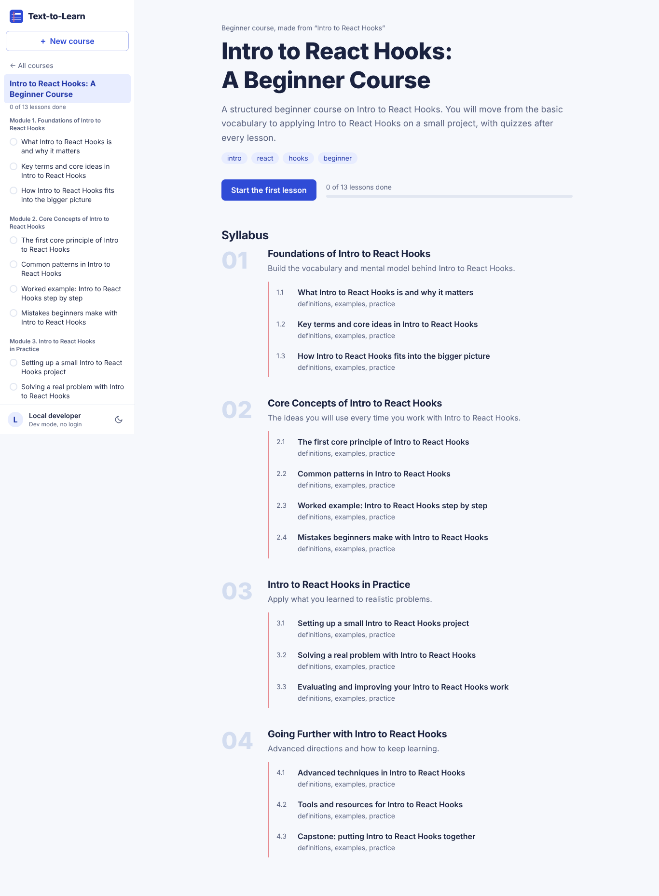
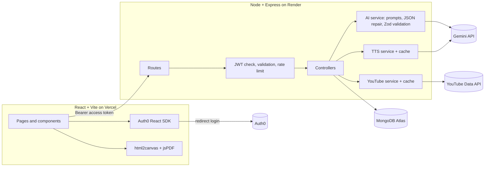

# Text-to-Learn: AI-Powered Course Generator

Type a topic like "Intro to React Hooks" or "Basics of Copyright Law" and get a full online course: 3 to 6 modules, 3 to 5 lessons each, with objectives, key topics, readings, an embedded YouTube video, a graded quiz, PDF export and a Hinglish audio explanation. Courses are saved per user behind Auth0 login.

**Live demo:** https://YOUR-APP.vercel.app  
**API:** https://YOUR-API.onrender.com/api/health  
**Video walkthrough (5 min):** https://YOUR-VIDEO-LINK



## Features

| Feature | How it works |
| --- | --- |
| Prompt to course | `POST /api/courses/generate` asks Gemini for a strict JSON outline, validates it with Zod, and stores Course, Module and Lesson documents |
| Rich lessons | Lessons are written on first open (lazy generation) as typed blocks: heading, paragraph, list, code, callout, video, mcq |
| Quizzes | 4 to 5 MCQs per lesson with explanations, graded in the browser with a running score |
| Videos | The model writes a search query, never a link. The server calls YouTube Data API v3 (`videoEmbeddable=true`) and caches results for 24 h |
| Hinglish narration | Gemini rewrites the lesson as spoken Hinglish, Gemini TTS voices it, the server returns a `.wav`. If TTS is unavailable the browser voice reads the same script |
| PDF export | A hidden print layout is captured with html2canvas and paged into jsPDF. Page breaks fall between blocks, never through a paragraph. Light and dark versions |
| Auth | Auth0 redirect login (Universal Login), JWT verified on every API route, users stored by Auth0 `sub` |
| Progress | Mark lessons done; progress shows on the course page, the sidebar and the course list |
| Extras | Learner level (beginner/intermediate/advanced), rewrite a lesson, delete a course, dark mode, mobile layout, keyboard and screen reader friendly |

## Architecture



### Generation pipeline

1. **Outline.** `generateCoursePrompt(topic, level)` asks for title, description, tags and modules with lesson titles and key topics. The response is requested as JSON with a schema, then parsed leniently (fences and stray text stripped) and validated with Zod. Extra modules or lessons are trimmed to 6 and 5; too few triggers one retry that tells the model what was wrong.
2. **Lesson (on demand).** Opening a lesson calls `generateLessonPrompt(course, module, lesson)` with the sibling lesson titles so content does not repeat. Every block is validated on its own: bad blocks are dropped instead of failing the lesson, quizzes are moved to the end, one video is guaranteed, reading URLs must be https.
3. **Token savings.** Only the outline is generated up front. Lesson content is written the first time someone opens it, the first lesson is warmed in the background, concurrent requests for the same lesson share one model call, the Hinglish script is stored on the lesson, and YouTube and audio responses are cached.

### Data model

```
User   { sub, email, name, picture }
Course { title, description, topic, level, creator(sub), tags[], modules[] -> Module }
Module { title, summary, order, course -> Course, lessons[] -> Lesson }
Lesson { title, order, objectives[], keyTopics[], readings[], content[Mixed],
         isEnriched, isCompleted, hinglishScript, module -> Module, course -> Course }
```

Lesson `content` example:

```json
[
  { "type": "heading", "text": "Introduction to AI" },
  { "type": "paragraph", "text": "Artificial intelligence is a field of computer science..." },
  { "type": "code", "language": "python", "text": "print('Hello, AI!')" },
  { "type": "video", "query": "AI explained for beginners" },
  { "type": "mcq", "question": "What is AI?", "options": ["A robot", "A field of computer science", "A language"], "answer": 1, "explanation": "..." }
]
```

## API

All routes except `/api/health` need `Authorization: Bearer <Auth0 access token>`.

| Method | Route | Purpose |
| --- | --- | --- |
| GET | `/api/health` | Status of DB, AI provider, TTS, YouTube |
| GET | `/api/me` | Current user |
| POST | `/api/courses/generate` | `{ topic, level }` creates a course |
| GET | `/api/courses` | Your courses with progress |
| GET | `/api/courses/:id` | Course with modules and lesson summaries |
| DELETE | `/api/courses/:id` | Delete course, modules and lessons |
| GET | `/api/lessons/:id` | Lesson plus breadcrumb and prev/next |
| POST | `/api/lessons/:id/generate` | Write lesson content (`{ force: true }` rewrites) |
| PATCH | `/api/lessons/:id/progress` | `{ completed }` |
| POST | `/api/lessons/:id/hinglish` | Hinglish script `{ text }` |
| GET | `/api/lessons/:id/audio` | Hinglish narration as `audio/wav` |
| GET | `/api/youtube?query=` | Embeddable videos for a query |

Errors are always JSON `{ error }`. Other users' courses return 404, invalid ids 400, AI failures 502.

## Project structure

```
text-to-learn/
├── server/                     Express API (deployed to Render)
│   ├── server.js               entry point
│   ├── app.js                  middleware stack
│   ├── routes/                 endpoint definitions + input schemas
│   ├── controllers/            course, lesson, youtube handlers
│   ├── middlewares/            Auth0 JWT + user sync, validation, rate limits, errors
│   ├── models/                 User, Course, Module, Lesson
│   ├── services/ai/            prompts, Gemini provider, template engine, validators
│   ├── services/               lesson enrichment, YouTube, TTS
│   ├── utils/                  cache, WAV helpers, errors
│   ├── config/                 env + DB connection
│   └── tests/                  unit + API integration tests
├── client/                     React app (deployed to Vercel)
│   └── src/
│       ├── components/         PromptForm, SidebarNavigation, LessonRenderer, LessonPDFExporter,
│       │   └── blocks/         HeadingBlock, ParagraphBlock, CodeBlock, VideoBlock, MCQBlock, ...
│       ├── pages/              Home, CoursePage, LessonPage, AuthRedirect, NotFound
│       ├── context/            AuthContext (Auth0 bridge), CoursesContext (shared cache)
│       ├── hooks/              useAuth, useApi, useTheme
│       └── utils/              api client, route helpers
├── .github/workflows/ci.yml    tests on every PR, deploy on main
└── render.yaml                 Render blueprint
```

## Run it locally

Requirements: Node 20+, and MongoDB (local `mongod` or a free Atlas cluster).

**Quick start with no accounts.** The server falls back to a built-in template engine when there is no Gemini key, and both sides have a dev login bypass:

```bash
# terminal 1
cd server
cp .env.example .env          # set MONGO_URI, AUTH_DISABLED=true
npm install
npm run dev                   # http://localhost:5000

# terminal 2
cd client
cp .env.example .env          # leave VITE_AUTH0_* empty
npm install
npm run dev                   # http://localhost:5173
```

**Full setup.** Fill in the keys below and set `AUTH_DISABLED=false`.

| Variable | Where | Value |
| --- | --- | --- |
| `MONGO_URI` | server | Atlas connection string |
| `CORS_ORIGINS` | server | `http://localhost:5173,https://your-app.vercel.app` |
| `AUTH0_ISSUER` | server | `https://YOUR_TENANT.auth0.com/` (trailing slash) |
| `AUTH0_AUDIENCE` | server + client (`VITE_AUTH0_AUDIENCE`) | API identifier, e.g. `https://text-to-learn-api` |
| `GEMINI_API_KEY` | server | Google AI Studio key |
| `GEMINI_TEXT_MODEL` / `GEMINI_TTS_MODEL` | server | defaults `gemini-3.5-flash-lite` / `gemini-3.8-flash-lite-tts` |
| `YOUTUBE_API_KEY` | server | Google Cloud key with YouTube Data API v3 enabled |
| `VITE_API_URL` | client | backend URL |
| `VITE_AUTH0_DOMAIN`, `VITE_AUTH0_CLIENT_ID` | client | from the Auth0 SPA application |

The YouTube key lives only on the server, so it is never shipped in the browser bundle.

### Auth0 setup

1. **APIs > Create API.** Identifier `https://text-to-learn-api`, signing RS256. Turn on **Allow Offline Access** (refresh tokens).
2. **Applications > Create > Single Page Application.** In settings add your URLs (local and Vercel) to Allowed Callback URLs, Allowed Logout URLs and Allowed Web Origins.
3. Copy Domain and Client ID into the client env, and the API identifier into both.

## Tests

```bash
cd server && npm test     # validators, prompt rules, mock engine, WAV/cache + full API flow against MongoDB
cd client && npm test     # lesson rendering, quiz grading, prompt validation
```

The API tests use `MONGO_URI_TEST` when set (CI starts a `mongo:7` service) and otherwise try an in-memory MongoDB.

## Deployment and CI/CD

- **Backend on Render.** New Web Service from this repo, root directory `server`, build `npm ci`, start `npm start`, health check `/api/health`, env vars from the table. Or use **New > Blueprint** with `render.yaml`.
- **Frontend on Vercel.** Import the repo, root directory `client`, framework Vite, env vars `VITE_*`. `vercel.json` rewrites all routes to `index.html` so deep links work.
- **GitHub Actions** (`.github/workflows/ci.yml`) runs server tests against a real MongoDB plus client lint, tests and build on every pull request. On `main`, after both pass, it calls the Render deploy hook (`RENDER_DEPLOY_HOOK_URL` secret). Vercel deploys `main` and creates preview deployments for PRs through its GitHub integration.
- **Workflow.** Each milestone was built on its own feature branch (`feat/...`) and merged into `main`.

## Design notes

The interface borrows from an Indian school exercise book: cool ruled paper, navy ink, fountain-pen blue for actions and the red margin line on the topic prompt. Type is Bricolage Grotesque for headings and Atkinson Hyperlegible Next for reading, chosen for legibility for students reading in a second language.

## License

MIT
